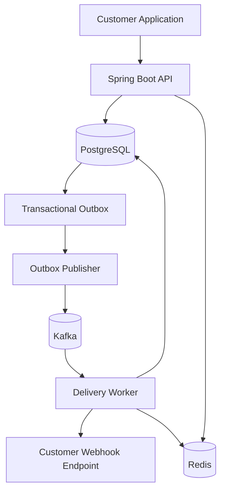

# HookFlow Architecture

## Overview

HookFlow is a multi-tenant webhook delivery platform.
It accepts events through a REST API, persists them in PostgreSQL,
and delivers them asynchronously to customer endpoints.

## Architecture Diagram

## Runtime Units

| Unit | Responsibility | Dependencies |
|---|---|---|
| API | Tenant authentication, request validation, event acceptance | PostgreSQL, Redis |
| Outbox publisher | Publish pending outbox records to Kafka | PostgreSQL, Kafka |
| Delivery worker | Deliver HTTP requests, retry failures, record attempts | Kafka, PostgreSQL |
| PostgreSQL | Persist tenants, endpoints, events, attempts and outbox records | Persistent storage |
| Kafka | Transport asynchronous delivery jobs | Broker storage |
| Redis | Support rate limiting and caching | Redis server |

## Component Responsibilities

### API

The Spring Boot API exposes REST endpoints for tenant management,
webhook subscriptions and event submission. It validates requests and
persists accepted events before reporting successful acceptance.

### Delivery Worker

The worker runs separately from the API process using the same codebase.
It consumes delivery jobs, signs outgoing requests, performs HTTP delivery,
and records results. Retry scheduling and dead-letter handling are part
of the delivery lifecycle.

### PostgreSQL

PostgreSQL is the durable source of truth for application state.
The event and its outbox record are written in the same transaction.

### Kafka

Kafka transports delivery jobs asynchronously from the outbox publisher
to delivery workers. Consumers must tolerate duplicate messages.

### Redis

Redis supports low-latency operations such as rate limiting and caching.
It is not the source of truth for durable events.

## Reliability

- Event acceptance uses database transactions and an outbox.
- Outbox publishing is at-least-once.
- Consumers must be idempotent.
- Failed webhook deliveries are retried according to delivery policy.
- Exactly-once external HTTP side effects are not guaranteed.

## Tenant Isolation

Every tenant-owned resource must be scoped to the authenticated tenant.
Authorization and tenant scoping must be enforced server-side.

## Initial Deployment Approach

Start with one Spring Boot codebase, with API and worker modes that can
run as separate processes. PostgreSQL, Kafka and Redis run as supporting
infrastructure services.
